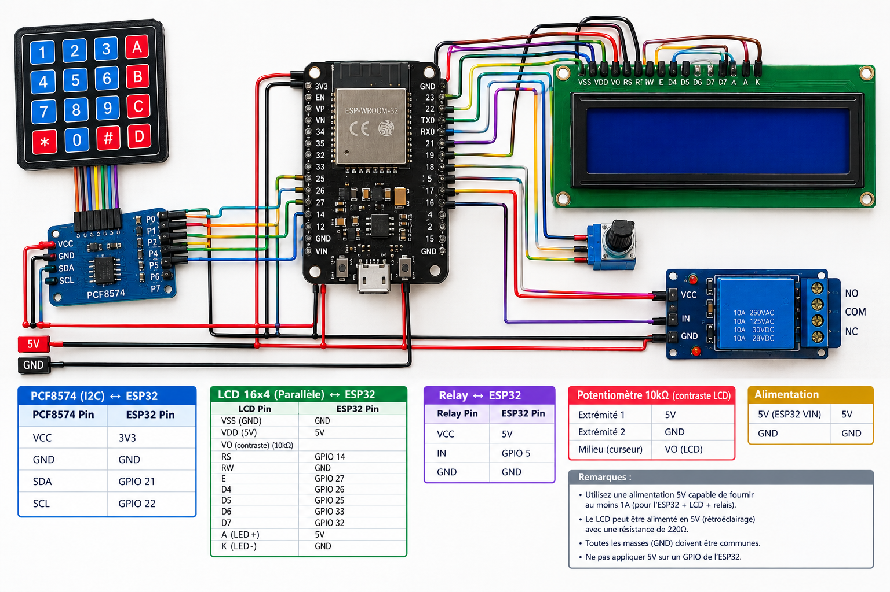
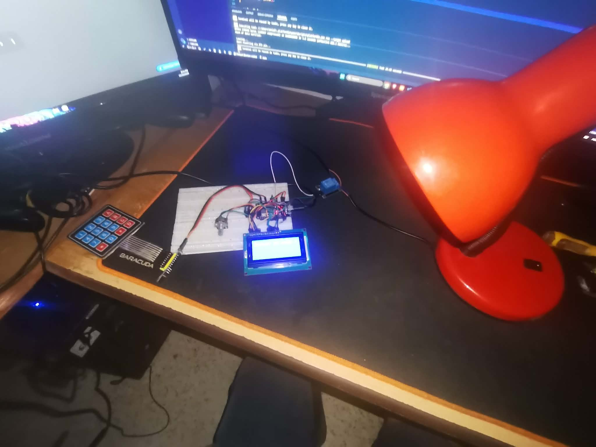
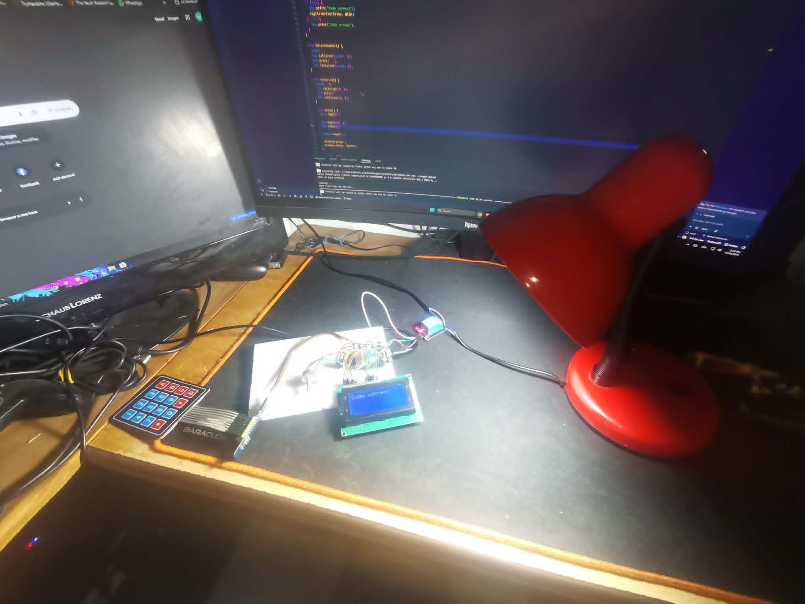

# SmartGate — Code-Protected Barrier Controller

An ESP32-based access control system that unlocks a physical barrier when the correct 4-digit PIN is entered via an I²C keypad. A relay triggers the lock mechanism, and a 16×4 LCD displays real-time feedback. Input auto-clears after 7 seconds of inactivity for added security.

## ⚡ TL;DR

The user is prompted on a 16×4 LCD screen to enter a 4-digit secret code using a 4×4 I²C keypad. Each keystroke is shown as `*` on the display. When all 4 digits are entered, the code is validated: a correct match activates a relay to open the barrier and shows "Code correct" on screen; a wrong entry displays "Code erroné" and resets. Any partial input is automatically cleared after 7 seconds of inactivity.

---

## ✨ Key Features

- 4-digit PIN code verification with real-time `*` masking on LCD
- I²C keypad input via PCF8574 GPIO expander — frees up ESP32 pins
- 16×4 LCD display with French-language prompts and result feedback
- Relay-controlled barrier/lock activation on correct code
- Backspace key (`C`) to delete the last entered digit
- Auto-clear timeout: input resets after 7 seconds of inactivity
- 3-second relay activation window before auto-close

---

## 🔄 How It Works

```
User approaches barrier
    → LCD displays "Entrer le code :"
    → User types 4 digits on the I²C keypad
    → Each digit is echoed as '*' on the LCD

Code validation (after 4 digits)
    → Input matches password → "Code correct"  + Relay ON (barrier opens)
    → Input does not match  → "Code erroné"   + Relay stays OFF

Post-result
    → 3-second display of result message
    → Relay deactivates (barrier closes)
    → LCD resets to entry prompt

Timeout
    → No keypress for 7 seconds with partial input
    → Input buffer clears, LCD resets to entry prompt
```

---

## 🔧 Hardware

| Component | Purpose |
|-----------|---------|
| ESP32 | Main microcontroller — logic, I²C master, relay control |
| 4×4 Keypad (I²C) | PIN digit entry via PCF8574 I²C expander |
| PCF8574 (0x20) | I²C GPIO expander driving the keypad matrix |
| LCD 16×4 | Displays prompts, masked input, and result messages |
| Relay Module | Activates the barrier/lock on correct PIN |

---

## 🔌 Wiring

| Component | ESP32 GPIO |
|-----------|-----------|
| LCD RS | GPIO 32 |
| LCD E | GPIO 33 |
| LCD D4 | GPIO 25 |
| LCD D5 | GPIO 26 |
| LCD D6 | GPIO 27 |
| LCD D7 | GPIO 5 |
| Relay signal | GPIO 4 |
| PCF8574 SDA | GPIO 21 (default I²C SDA) |
| PCF8574 SCL | GPIO 22 (default I²C SCL) |

> The PCF8574 I²C address is set to `0x20`. The relay is active-HIGH — it activates when GPIO 4 goes HIGH.

---

## 🖥️ Project Images

### Wiring & Hardware



### Firebase — Realtime Database (OFF state)



### Firebase — Realtime Database (ON state)



---

## 📦 Dependencies

| Library | Version |
|---------|---------|
| LiquidCrystal | ^1.0.7 |
| Keypad | latest |
| Keypad_I2C | latest |
| PCF8574 (robtillaart) | ^0.4.6 |
| AceButton | ^1.10.1 |

---

## 🚀 Getting Started

1. Clone or download this repository.
2. Open the project in [PlatformIO](https://platformio.org/) (VS Code extension or CLI).
3. Wire all components as described in the **Wiring** table above.
4. Set your desired PIN in `src/main.cpp`:
   ```cpp
   char password[4] = {'1', '2', '5', '7'};
   ```
5. Build and upload to your ESP32:
   ```bash
   pio run --target upload
   ```
6. Open the Serial Monitor at **115200 baud** to observe debug output.
7. The LCD will prompt `Entrer le code :` — the system is ready.
